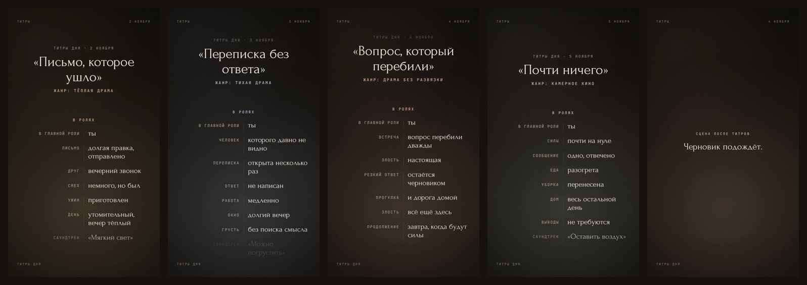

# Титры

**Каждый день заслуживает титров.** Человек рассказывает голосом или текстом, что было сегодня, и получает короткий ролик: титры своего дня с музыкой, как в конце фильма.

Версия 0.2 — реализация решений из разбора концепции. Что сделано и почему: [docs/DECISIONS.md](docs/DECISIONS.md).



Готовые ролики четырёх дней из прототипа — в папке [`samples/`](samples/).

## Что здесь есть

| Часть | Зачем | Запуск |
|---|---|---|
| **Монтажная** (`studio/`, `server/app.js`) | Ручной консьерж-тест: рассказ → черновик → правка → MP4 для участника → журнал откликов | `npm run studio` |
| **Telegram-бот** (`server/bot.js`) | Тот же путь без человека: голос или текст → черновик с кнопками → ролик в чат | `npm run bot` |
| **Движок** (`engine/`) | Модель эпизода с проверками бережности и рендерер титров на Canvas | используется всеми частями |
| **Рендер** (`server/render.js`) | MP4 9:16 со звуком: Chromium рисует кадры, ffmpeg собирает видео | `npm run render -- examples/day-warm.json out.mp4` |
| **Бренд** (`brand/`) | Знак в кривых, иконка, токены, обложка и аватар бота, гайд | `npm run brand` |
| **Консьерж-тест** (`concierge/`) | Протокол на 7 дней, согласие, шаблоны сообщений, анкета, таблица метрик | — |

## Быстрый старт

Нужны Node.js 20+, ffmpeg и Playwright с Chromium.

```bash
npm install
npx playwright install chromium   # если Chromium для Playwright ещё не установлен
npm test
npm run studio                    # http://127.0.0.1:4173
```

В монтажной выберите «Пример», чтобы открыть один из четырёх дней прототипа в новой грамматике. Или вставьте свой рассказ и нажмите «Собрать черновик».

Без ключей всё работает на **заготовке без ИИ**: каждая фраза рассказа становится строкой, которую вы сокращаете вручную. С ключом `ANTHROPIC_API_KEY` черновик пишет Claude. Каждая его строка сверяется с рассказом, а строки без дословной опоры отбрасываются.

## Бот

```bash
cp .env.example .env              # заполните TELEGRAM_BOT_TOKEN, METRICS_SALT (≥16 знаков) и TITRY_BLOCKED_HMAC_KEY
set -a; . ./.env; set +a
npm run bot
```

- **Голосовые** включаются ключами Yandex SpeechKit (`YANDEX_API_KEY`, `YANDEX_FOLDER_ID`). Без них бот просит писать текстом.
- **Правки** — текстом в ответ на черновик: `2: вечерний звонок`, `-3`, `+ Окно — долгий вечер`, `название: …`, `после: …`. Подсказка — `/help`.
- **`/year`** — титры 2026 года из одного рассказа.
- **`/delete`** — удаляет сессию и метрики пользователя.
- **Хранение.** Рассказы живут только в памяти сессии (до 3 часов) и не пишутся на диск. Ролик удаляется сразу после отправки; ролики, оставшиеся после сбоя, удаляются при следующем запуске бота (поэтому на одной рабочей копии — один процесс бота). Без `METRICS_SALT` бот не запускается. В `data/metrics.jsonl` попадают только события и хэш id.
- **Для теста** хватит одного сервера с 2 ГБ памяти. Ролик 720×1280 собирается примерно за 20 секунд, ролики идут в очередь по одному.

## Бережность, встроенная в код

- В титрах только то, что человек сказал сам: у каждой строки есть цитата-источник.
- Род не угадывается по имени. Он берётся только из слов человека о себе, иначе строки пишутся именными фразами.
- Слова «финал» и «конец» без «сцены», навязанный позитив и мотивы других людей отмечаются при проверке.
- **Фильтр опасных тем** (`server/safety.js`) — нижняя граница, а не надёжное обнаружение риска. Слоёв два: фразы и флаг модели. Если сработал любой, ролик не делается, а человек видит контакты помощи. Неподтверждённые номера в `config/help.json` не показываются.
- Ответ «стало тяжелее» после ролика отправляет человеку контакты помощи и не предлагает продолжать.

## Тесты

`npm test` — 64 теста:

- проверки эпизода и рода;
- фильтр безопасности, включая гонки параллельных запросов (остановка важнее любого незавершённого «можно»);
- черновик Claude с подменённым клиентом;
- заготовка без ИИ;
- полный сценарий бота;
- настоящий рендер MP4 через Chromium и ffmpeg;
- нарезка голосовых.

Не проверялись в этой сборке, потому что нужны ключи: реальные вызовы Claude API, Yandex SpeechKit и Telegram Bot API.

## Лицензии

Шрифты Forum, Golos Text и JetBrains Mono распространяются по SIL OFL 1.1 (`engine/fonts/LICENSE-*.txt`). Звуковые эскизы в `assets/audio` — оригинальный синтез из прототипа.
