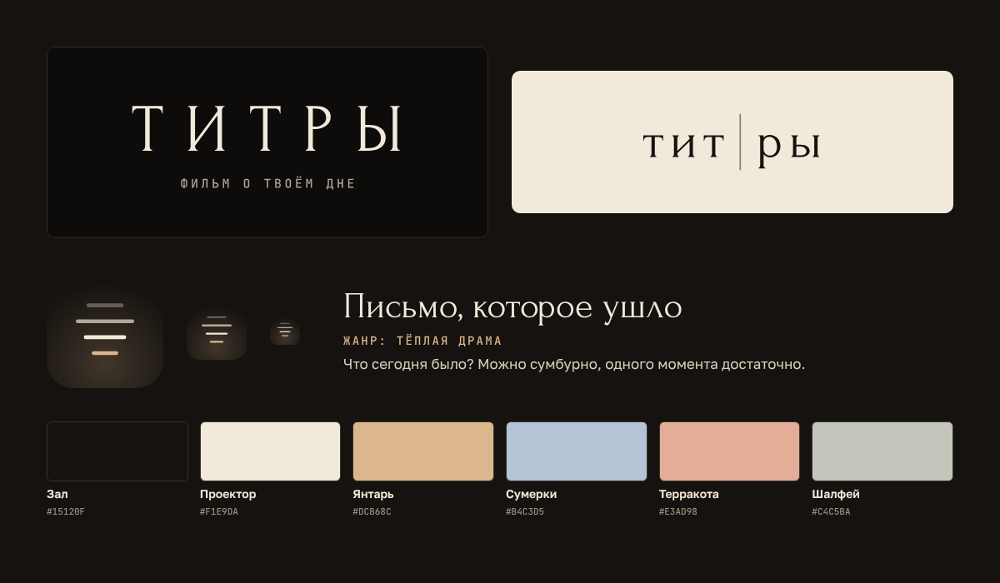

# Бренд «Титры»

**Мир бренда — зал после сеанса.** Фильм кончился, свет ещё не включили, на экране идут титры. Тёплая темнота вместо чёрного, проекторный свет вместо белого, одна тонировка («плёнка») на настроение дня.

## Знак

| Файл | Где использовать |
|---|---|
| `logo-wordmark-light.svg` | Основной: на тёмном, с дескриптором «фильм о твоём дне» |
| `logo-wordmark-light-short.svg` | На тёмном, когда дескриптор не помещается |
| `logo-wordmark-ink.svg` | На светлом (бумага, печать) |
| `logo-axis-light.svg`, `logo-axis-ink.svg` | Вариант с осью титров: для мерча, обложек, крупных форматов |
| `icon.svg`, `png/icon-*.png` | Иконка приложения: строки титров, верхняя гаснет |
| `icon-mono.svg` | Одноцветная иконка (`currentColor`): уведомления, монохромные значки |
| `png/telegram-avatar-640.png`, `png/telegram-cover-640x360.png` | Аватар и картинка описания бота (загружаются через @BotFather) |

Надписи в логотипах переведены в кривые и не зависят от установленных шрифтов. Пересборка: `python brand/tools/outline.py` (нужен `pip install fonttools brotli`), растровые файлы — `npm run brand`.

**Фирменный приём — ось титров.** Классические титры набираются по центральной оси: роль справа налево, имя слева направо. Тонкая вертикальная линия есть в логотипе, в каждом ролике и в монтажной. Не добавляйте её как украшение туда, где нет пары «роль — значение».

**Охранное поле** — высота буквы «Т» со всех сторон. Минимальный размер словесного знака — 96 px по ширине, иконки — 29 px.

## Цвет

Токены: [`tokens.css`](tokens.css), [`tokens.json`](tokens.json).

- **Зал** `#15120F` — фон. Никогда не чистый чёрный.
- **Проектор** `#F1E9DA` — текст на тёмном; фон светлых носителей.
- **Плёнки** — по одной на эпизод: Янтарь `#DCB68C` (тепло), Сумерки `#B4C3D5` (грусть), Терракота `#E3AD98` (злость), Шалфей `#C4C5BA` (тишина). Плёнка меняет тонировку, а не смысл. Для злости — приглушённая терракота, а не тревожный красный.
- Две плёнки в одном кадре не смешиваются.

## Шрифты

Все три — SIL Open Font License 1.1, файлы в `engine/fonts`.

| Роль | Шрифт | Правило |
|---|---|---|
| Титры, названия | Forum | Только строчные и прописные без разрядки. Исключение — словесный знак (разрядка .32em) |
| Интерфейс | Golos Text 400/600 | Основной текст, кнопки |
| Роли, даты, таймкоды | JetBrains Mono 500 | Капсом с разрядкой .14em, мелко |

## Движение

- Основа — «Кино»: название стоит 3 секунды, затем ровный подъём титров до «Конец сцены».
- После «Конец сцены» — полторы секунды темноты и **сцена после титров**: одна строка. Это фирменный финал, он одинаков в каждом ролике.
- Режим без движения — статичные кадры со склейками, без сдвигов и затуханий.
- Никаких вспышек, тряски и ускорения ради эффекта.

## Словарь

| Вместо | Говорим |
|---|---|
| рассказ, запись | сеанс |
| редактирование | монтаж |
| стиль, тема | плёнка |
| неделя | мини-сериал |
| месяц, год | сезон, полный метр |
| архив | фильмотека |
| финал, конец | конец сцены, до завтра |

## Голос

На «ты», коротко, тепло, без восклицаний. Не обещаем, что станет легче. Не говорим «финал». Не угадываем род человека: пишем именными фразами («Письмо — отправлено»), пока человек сам не скажет о себе «устал» или «устала».

**Слоган:** Каждый день заслуживает титров.
**В сторе:** Титры — фильм о твоём дне.
